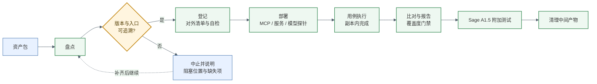

# sci-asset-verify-skill

用于科学数字资产交付前的自查。资产包提交前，使用本 skill 完成一次完整核验，确认资产可用、清单合规、结果与期望值一致，并在交付环节之前修正不符合项。

## 用途

资产提交后，接收方将依据对外发版口径逐项核验。清单字段不完整、用例覆盖不足、结果与期望值不一致，均会导致交付被退回，并额外产生一轮沟通与整改。

本 skill 将上述核验要求前置到提供方一侧：采用与接收方一致的内置标准与判定规则，执行完整核验流程，产出可直接随包提交的资产清单与验证报告，减少交付环节的返工。

## 安装

本 skill 是**一个目录**，装到 agent 能读到的 skills 位置即可。推荐用 git 安装（这样才能用上"开跑自动对齐最新版"）。

### 1. 用 git 安装（推荐）

```bash
# DSH：装到用户级 skills 目录（也可放项目的 .dsh/skills/ 下，仅该项目生效）
mkdir -p ~/.dsh/skills
git clone --depth 1 https://github.com/KnowledgeXLab/sci-asset-verify-skill.git \
    ~/.dsh/skills/sci-asset-verify-skill

# 想钉在某个版本上：加 --branch
git clone --depth 1 --branch 1.2-beta.5 https://github.com/KnowledgeXLab/sci-asset-verify-skill.git \
    ~/.dsh/skills/sci-asset-verify-skill
```

其他 agent（Claude Code / Codex / Cursor 等）：把同一仓库 clone 到它的 skills 目录即可，技能说明在 `SKILL.md`。

### 2. 验证安装

```bash
cd ~/.dsh/skills/sci-asset-verify-skill
cat VERSION                                  # 当前版本，如 1.2-beta.5
python3 tests/selftest.py                    # 自测：应显示「自测结果：N/N 通过」
python3 scripts/update_skill.py --check      # 与远端最新 tag 比对
python3 scripts/validate_envelope.py --help  # 任一脚本能跑即说明依赖就绪
```

### 3. 更新

装好之后**不必再人工 pull**：每次核验开始时 `scripts/update_skill.py` 会检查远端最新 tag，
有新版就切过去（工作区有未提交改动时拒绝更新，不覆盖本地修改）；也可以手动：

```bash
python3 scripts/update_skill.py --apply        # 切到远端最新 tag，并自动跑一次自测
python3 scripts/update_skill.py --apply --no-update   # 本次不更新
```

### 4. 离线 / 无 git 的安装方式

直接拷贝整个目录到 skills 位置也能用（依赖已随 `vendor/` 打包，无网络也能跑），
但**自动更新不可用**——`update_skill.py` 会提示"非 git 安装，请重新下发最新版"。


### 装在哪里：权限与自动更新的取舍

自动更新要写 skill 目录（工作区 + `.git`），所以**装在哪里取决于 agent 的写权限**：

| 安装位置 | 自动更新 | 说明 |
|---|---|---|
| **项目级** `<项目>/.dsh/skills/sci-asset-verify-skill` | ✅ 可用 | 在会话工作区内，`workspace-write` 沙箱即可写 |
| **用户级** `~/.dsh/skills/sci-asset-verify-skill` | ⚠️ 视权限 | 会话若只允许写工作区（`workspace-write`），`git checkout` 会被拒；此时脚本报 `无写权限，跳过自动更新`（**不中断核验**），需放宽权限或手动 pull |

脚本的行为：更新前先探测目录可写性，不可写就**降级为提示**（退出码 0，核验继续），并给出三条路——
放宽会话写权限、手动 `git pull`、或重新下发最新版。要强制关闭自动更新：`--no-update` 或 `ASSET_VERIFY_NO_UPDATE=1`。

### 环境要求

| 项 | 要求 |
|---|---|
| Python | ≥ 3.10（仅标准库 + 随包 `vendor/`） |
| git | 仅"安装/自动更新"需要；离线拷贝安装可不要 |
| 网络 | 自动更新、`--check` 需要能访问 GitHub；核验本身不需要联网 |
| 第三方依赖 | 无（`vendor/openpyxl`、`vendor/jsonschema` 已内嵌） |

## 开发与部署分离

本仓库有两条使用面，**不要混用**：

| 位置 | 用途 | 版本要求 |
|---|---|---|
| `<工作区>/sci-asset-verify-skill`（本仓库） | **开发**：只在这里改代码 | 开发分支 `dev`，`VERSION` 带 `-dev` 后缀 |
| `<工作区>/.dsh/skills/sci-asset-verify-skill` | **部署**：其他会话/其他用户实际跑的那份 | 只放**已发布 tag**（`git clone --branch <tag>`），由 `scripts/update_skill.py` 自动跟进 |

流程：

1. 开发只在 `dev` 分支（`git switch dev`）进行，`main` 保持与最近一次发布一致；
2. 发版：`VERSION` 去掉 `-dev` → 合并到 `main` → 打 tag → 推送；
3. 部署目录 `git fetch --tags && git checkout <新 tag>`（或直接跑 `scripts/update_skill.py --apply`）。

`update_skill.py` 在**开发分支上会自动跳过**（输出 `开发分支，跳过自动更新`），避免把开发工作区切到发布 tag；
只有部署目录（detached HEAD 或 main）才会真的切换版本。

## 跨 harness 使用（不假设对方的 agent 框架）

核验流程不依赖任何特定 harness。任何 agent（DSH / Claude Code / Codex / Cursor / 其它）都从同一条命令开始：

```bash
python3 scripts/verify_entry.py --package <包根> --init     # 建批次目录 + 写固定执行合同
python3 scripts/verify_entry.py --package <包根> --emit-prompt   # 只看合同，不落盘
```

`<批次>/verify-task.md` 是**由 skill 生成的固定执行合同**：包含必跑命令、判定口径（P0/P1/P2 与不校验项）、
报告门禁与交付要求。执行者照它执行即可，结论由脚本门禁校验（`probe_package.py --evaluate`、
`check_coverage.py`、`check_report.py`），不靠模型自觉，也不要求 harness 支持子智能体。

要**隔离历史上下文**（不让之前的会话/判断影响本次结论）：

```bash
python3 scripts/verify_entry.py --package <包根> --isolated        # 全新进程按合同执行
python3 scripts/verify_entry.py --package <包根> --isolated --dry-run   # 只看会启动什么
```

`--isolated` 复用 `scripts/harnesses/` 里的适配器（默认首选已安装的第一个，`--harness dsh|codex|claude|kimi|qwen|opencode|cursor` 可指定），
在独立进程中执行合同，主进程只输出 `P0/P1 数量、覆盖摘要、报告与日志路径`；凭据只经环境变量注入，
跑完清理残留凭据。支持子智能体的 harness 也可以直接把合同喂给全新子智能体——效果等价。

各 harness 的凭证与权限按注册表的 `env_map` / `argv` 声明解析（本机实测可用的写法）：

| harness | 关键参数 | 凭证来源（按顺序） |
|---|---|---|
| `dsh` | `--profile headless --permission-mode workspace-write` | `~/.dsh/.credentials.yaml` 的 `*_API_KEY`（仅环境变量） |
| `codex` | `exec --skip-git-repo-check -s workspace-write` | `env:OPENAI_API_KEY` → `~/.codex/auth.json` → `cred:DEEPSEEK_API_KEY` |
| `claude` | `-p --permission-mode bypassPermissions --add-dir <skill> --add-dir <包>` | `env:ANTHROPIC_AUTH_TOKEN` → `~/.bashrc` 的 export（含 `${VAR%…}` 派生） |
| `opencode` | `run --title <固定标题> --auto`（模型用 opencode 配置默认） | `env:OPENAI_API_KEY` → `~/.bashrc` → `~/.codex/auth.json` → dsh 凭据 |
| `cursor` | `agent -p --force --output-format text` | 走 Cursor 自身登录态（`agent login`）或 `CURSOR_API_KEY` |
| `kimi` | `kimi -p <prompt>`（`-p` 与 `--auto` 互斥） | 走 `~/.kimi/config.toml` 的 provider/模型 |
| `qwen` | `qwen -p <prompt> --approval-mode yolo` | 走 `~/.qwen/settings.json` 与其登录态 |
| `zcode` | —（桌面应用，无 headless CLI） | 不适用 |

实测状态（2026-11-25，本机）：

| harness | 状态 | 说明 |
|---|---|---|
| `dsh` / `codex` / `claude` | ✅ 整包核验跑通 | 都有 `P0 0 / P1 0` 报告与完整证据 |
| `opencode` | ✅ 整包核验跑通 | 9 资产 / 38 例全通过、`P0 0 / P1 0`；三个坑已修（`--title`、`--auto`、子进程 `PWD` 同步） |
| `kimi` | ✅ 最小包跑通 | `-p` 与 `--auto` 互斥已修；报告 `P0 0 / P1 0` |
| `qwen` | ⏳ 慢但可跑 | 能完整推进（probe/coverage/harbor 均有产物），单批 >10 分钟 |
| `zcode` | ⛔ 不可无头调用 | Electron 桌面应用，`zcode` 只启动 GUI；适配器标 `headless=False` 并报错说明 |
| `cursor` | ⛔ 未鉴权 | CLI 已装（2026.11.22），缺 `CURSOR_API_KEY` 或 `agent login` |

> 非交互场景下 claude 必须 `bypassPermissions` + `--add-dir`，否则所有命令都要审批；opencode 必须 `--auto`，否则非 TTY 下会等审批挂住；
> cursor 需先 `agent login` 或设 `CURSOR_API_KEY`。内网自签网关（自定义 provider）需要 `NODE_TLS_REJECT_UNAUTHORIZED`
> 或 `NODE_EXTRA_CA_CERTS`，skill 只继承用户已有设置、不会主动关闭校验。

## 使用方法

装好之后（见上节「安装」）无需额外配置，直接让 agent 使用本 skill 即可；也可把 `SKILL.md` 路径提供给 agent，由其按其中步骤执行。

执行前需明确核验对象与核验范围，例如：

```
用 sci-asset-verify-skill 自查 /data/delivery/some-package-2.1.0/ 这个包，
全量跑一遍，清单按对外发版口径填，交付前我想知道还有哪些项没过。
```

可根据进度调整范围：

- 材料尚未齐备，仅需确认缺口：「只做盘点和填表，先别跑用例」
- 服务已部署，仅需补跑用例：「跳过部署，直接用 http://xxx 那个服务」
- 上次执行中断：「接着 `asset-runs/run-20261114-105545` 那次继续」

资产涉及大模型调用且需进行 Sage A1.5 兼容性验证时，应提供 `SAGE_BASE_URL`、`SAGE_MODEL`、`SAGE_API_KEY`。未提供时，agent 将暂停并向用户索取，不会跳过该环节。

核验完成后，资产目录下生成 `asset-runs/run-[YYYYMMDD]-[hhmmss]/`（批次目录名固定为「日期-时分秒」，便于按时间追溯）。其中以下三项为主要交付物：

- `validation-report.md`：核验结论，含通过项、未通过项及原因
- `registration/科学数字资产清单.xlsx`：可直接随包提交的资产清单
- `comparison.json`：逐条用例的期望值与实际值

其余文件为过程记录，供接收方复核时查阅。

## 检查范围

核验按六个阶段执行，每个阶段对应一类不符合项。

阶段一为资产盘点与使用说明。核查版本、入口、依赖、输入输出是否完整可追溯，常见问题包括目录名与版本号不一致、入口脚本缺失、依赖未声明。

阶段二为资产登记。按对外清单 23 列填写，表头、枚举、必填项、版本格式、一资产一行、用例引用可解析性均由脚本校验。使用内部字段口径、枚举值不在词表内、两行名称与版本重复等情况将直接报错。

阶段三为部署核验。存在 MCP 时完成注册并执行一次最小业务调用；存在模型时完成加载并执行一次推理。仅提供配置文件而服务不可用的情况不予通过。

阶段四为用例执行。使用资产包给定的用例逐条执行，记录输入、实际输出、退出码与耗时。用例缺失、期望值缺失、预期失败用例未按约定报错，均予以记录。

阶段五为比对与报告。逐项比对期望值，并按各类资产的用例数量下限核对覆盖度。通过率未注明分母、覆盖度不足却宣称完成的，将在报告中明确指出。

阶段六为 Sage A1.5 附加测试，仅针对涉及大模型调用的资产。切换后端执行后单独成节，不影响交付结论。

核验结束后自动清理中间产物，仅保留报告类证据，随包提交的目录不会因执行核验而增大。

## 结论判读

用例状态分为四种：通过、失败、未判定、不适用。

未判定指缺少期望值或判定阈值，仅给出差值而不给出结论。不适用分两种情形：资产包内本不存在该类资产，属合规跳过；或本 skill 无对应验收步骤，属能力缺口，报告中标注「未覆盖」，交付前应与接收方确认处理方式。

判定遵循以下规则：

- 每个资产在清单中仅占一行，用例不额外占用资产行
- 通过率注明分母，例如「27/27」；未执行项单独列出，不计入分母
- 某类资产用例数低于下限时，报告标注「覆盖不足」
- 资产包内缺失的描述文件不由本 skill 补写
- Sage 附加测试结果仅说明后端切换后的可用性，不计入交付结论

## 依赖说明

资产清单生成依赖 openpyxl，已随本 skill 置于 `vendor/` 目录，纯 Python 实现，MIT 许可，无需另行安装。运行时按以下顺序解析：当前环境已安装的版本、`vendor/` 内置版本、自动安装；三者均不可用时终止并输出修复命令。可在离线环境与干净容器中直接执行。如需固定依赖行为，可设置 `ACI_ASSET_VERIFY_AUTO_INSTALL=0`。

## 执行流程



各阶段均产出机器可读回执。执行中断时保留现场并记录原因，不清理既有结果。

## 测试与验证环境

本 skill 已在下列环境完成完整流程测试，各项检查全部通过。

| 项目 | 环境 |
|---|---|
| 操作系统 | Linux x86_64，24 核 CPU，无 GPU |
| 运行时 | Python 3.12 |
| agent | DeepSeek Harness（DSH），Web 会话 |
| 驱动模型 | DeepSeek-V4.1-Flash-1017（DS-4.1） |

测试内容如下。

一、脚本自测。`tests/selftest.py` 覆盖全部二十个脚本，共 176 项断言，含正例与负例，全部通过。该套件不依赖真实资产包、不需要网络，执行时间约 3 秒。断言校验至具体报错字段与提示文案，不以退出码作为唯一依据。

```
python tests/selftest.py
```

二、完整流程验证。在数据、工具、工作流三类交付包上执行完整六阶段流程，159 条用例与判据全部完成判定，无遗留项；覆盖度门禁各类型均达标；数据侧逐文件核验 327 个实体、534,694 行记录，与声明不符 0 处。

三、附加测试路径验证。涉及大模型调用的资产已完成 Sage A1.5 附加测试，15 组用例通过 8 组。失败集中在问答与报告正文生成环节，原因在于被核验资产所依赖的后端服务，按既定规则不计入交付结论。

## 仓库结构

```
SKILL.md           六阶段流程的完整作业手册，agent 按此执行
references/        登记字段口径与示例、比较规则与报告格式、资产发现方法
scripts/           二十个自检脚本（另有 4 个内部模块）
assets/            内置标准：23 列清单 schema、包络 JSON Schema、用例数量下限
tests/selftest.py  脚本自测套件
vendor/            随包分发的 openpyxl
```

## 版本记录

> 当前开发版 `1.4-beta.1-dev`（未发版）：**跨 harness 统一入口**——`scripts/verify_entry.py` 把核验流程固化成
> 由 skill 生成的「执行合同」（`prompts/verify-task.md.tmpl` → `<run>/verify-task.md`），任何 agent 框架都照同一份合同跑；
> 结论仍由脚本门禁校验，不依赖模型自觉，也不要求对方支持子智能体。


> **Harbor 任务包支持**（合并 PR #1）：识别 task / 显式 dataset / 隐式 dataset 三种形态；静态检查入固定清单
> （`P0-HARB-STRUCT` 必需文件、`P0-HARB-RUN` oracle/nop 双 trial、`P1-HARB-DATASET`/`P1-HARB-ENVELOPE`/`P1-HARB-LINT`）；
> 执行走官方 CLI 全量 oracle+nop（`scripts/harbor_run.py`），跑不了记 blocked（不算 na 不算 fail）；task@harbor 不触发 Sage。

### 1.3-beta.1 — 2026-11-24

**Harbor 任务包校验（合并 PR #1）+ 四项误判修正**

- 新增 harbor / terminal-bench-science 格式支持：`scripts/_harbor.py`（形态识别、必需文件、任务 digest）、
  `scripts/harbor_run.py`（官方 CLI 跑 oracle+nop 双 trial，reward 结构化解析，环境不备记 blocked）
- 清单扩到 **P0×8 + P1×8 = 16 条**：`P0-HARB-STRUCT`/`P0-HARB-RUN`、`P1-HARB-DATASET`/`P1-HARB-ENVELOPE`/`P1-HARB-LINT`；
  原 PR 的 P2 项改为建议输出（清单不保留 P2 项）
- **修正 `P0-ENVELOPE` 假阴性**：探测按 `assets[]` 读而校验脚本输出 `results[]`，导致包络缺必填项也判 pass
- **修正 `P0-SECRET` 两处误报**：`task-01-without-knowledge` 被当成 `sk-` 密钥；`LLM_API_KEY=`（空值）跨行吃到下一行变量名
- **放宽 `P1-DOC-REF`**：剥掉 markdown 链接文字只认目标；token 在包内后缀唯一命中即视为存在；补产物目录与 skill 自带脚本路径
- `SKILL.md` 新增 2.6 节、`references/validation.md` 新增 harbor 用例口径；`case-minimums.json` 的 task 行改全量语义

- 自测 132 → **157 项断言**

### 1.2-beta.9 — 2026-11-20

**Sage 配置未就绪不再「只记未测」，改为阻断**

- 新增检查项 **`P0-SAGE`**（清单现为 **P0×6 + P1×5 = 11 条**）：需要 Sage 附加测试的资产
  （包内含 skill/agent 类资产即需要）若因环境变量/连通性等配置原因没跑通，且用户给不出可用配置 → 判 **P0**，
  须先完成配置（**API URL 与 API KEY 可在端砚平台（书生·Intern-Discovery）获取**）才能交付，不得以「未测」结案
- `probe_package.py` 新增 `--run-dir`：读 `sage-need.json` / `sage-config.json` / `sage-a1.5-report.json`，
  区分 `config_missing`（没配）/ `config_invalid`（配了但连不上、401/403）/ `not_run`（根本没用 Sage 跑）
- 索取配置的文案写清：只要在**环境变量**里设置 `SAGE_BASE_URL`/`SAGE_MODEL`/`SAGE_API_KEY`，
  不要把明文密钥贴进对话、写进文件或带进交付包
- `SKILL.md` 第 5 步固定带 `--run-dir` 跑判定；`check_report.py` 加守卫——需要 Sage 却没带 `--run-dir`
  （缺 `sage_profile`）或未跑通却没有 `P0-SAGE`，报告结构检查直接告警

- 自测 128 → **132 项断言**

### 1.2-beta.8 — 2026-11-19

**安全修复：核验过程不再把凭据落盘**

隔离 `DSH_HOME` 原先会把 `~/.dsh/.credentials.yaml` 复制进 run 目录，`asset-runs/` 随包外发即等于交付物含明文密钥。

- 隔离 `DSH_HOME` 只复制 profiles 与 node_modules 软链；**凭据在内存中解析** `*_API_KEY`
  （`AGENT_CENTER_API_KEY` / `DEEPSEEK_API_KEY` / `INKSTONE_API_KEY` …）后**经环境变量注入子进程**
- 新增 `scrub_secrets()`：每次运行结束（含异常分支）清理 `.credentials.yaml`、`.dsh-home-*`、
  `codex-home` / `claude-home` 及其 `auth.json`
- **新增检查项 `P0-SECRET`**（10 条清单里的第 5 条 P0）：包内出现凭据文件（`.credentials.yaml`、`auth.json`、
  带密钥的 `.env`）或明文密钥（`sk-…`、`Bearer …`、`*_API_KEY=<值>`）即**阻断交付**；
  扫描跳过 `asset-runs/`、`.asset-work/`、`node_modules/`、`vendor/`、`.tmp/`，避免插件示例文档误报

- 自测 125 → **128 项断言**

### 1.2-beta.7 — 2026-11-18

**四类误判修正（都来自真实包复核）**

- **容器内绝对路径不再判越界**：资产自身声明容器（`environment_type=docker`、`image`、`base_image`、自带
  `Dockerfile`/`compose.yaml`）或**同包存在声明了容器的 `environment` 资产**时，`/opt/…`、`/data/…` 记为 note；
  `/home/…`、`/Users/…`、`/root/…` 等宿主机路径仍判越界。结果里带 `container_context` 说明豁免依据
- **文档路径 token 不再被截断**：`image/x.tar.sha256` 曾被截成 `…tar.sh`、`a.shp` 曾被截成 `a.sh` 而误报缺失；
  扩展名改为必须落在文件名边界上。仅大小写不同的同名文件单独记 `case_only_mismatch`，不算缺失
- **`sage_probe.py detect` 支持 `catalog.json` 的路径数组**：`assets: ["x/asset.json", …]` 时不再
  `AttributeError`，逐条解析出资产类型
- **覆盖表 na 规则字段名修正**：`P1-VERIFY-DOC` 曾因读旧字段名而永远判 na（理由与事实相反），
  现在按实际 `cases_json` 判定；`validate/cases.json` 缺失时兜底取资产内任一 `cases.json`

- 自测 120 → **125 项断言**

### 1.2-beta.6 — 2026-11-17

**开跑自动对齐版本**

- 新增 `scripts/update_skill.py`：核验第一步检查远端最新 tag，有新版就 `git checkout` 过去，
  更新后自动跑一次自测；版本比较按语义序（`,alpha/beta/rc/正式`，`-dev` 后缀按同号处理）
- **不阻断核验**：非 git 安装、离线无 origin、工作区有未提交改动、目录不可写（如用户级安装但会话只能写工作区）
  → 一律打印状态并继续，`skill-update.json` 记录原因；`--no-update` / `ASSET_VERIFY_NO_UPDATE=1` 可关闭
- 报告 front matter 的 `skill_version`/`skill_commit` 自然反映更新后的版本；同一批核验内不中途切换

**README 新增「安装」章节**（在「使用方法」之前）：git 安装（可 `--branch` 钉版本）、验证安装、
更新方式、离线拷贝安装的限制，以及「装在哪里：权限与自动更新的取舍」（项目级可自动更新 / 用户级视会话权限）

- 自测 114 → **120 项断言**

### 1.2-beta.5 — 2026-11-17

**判定口径固定，结论可复现**

- P0×6 / P1×5 写死：P0 = 包结构、包络合规、资产完整性（含引用包外/绝对路径）、可执行验证入口与结论、不得含凭据/密钥（`P0-SECRET`）、Sage 附加测试未跑通（`P0-SAGE`）；
  P1 = 文档引用不存在、版本口径不一致、声明与实体/实现不符、文档事实或算术错误、验证说明与用例不一致
- `scripts/probe_package.py` 出**确定性事实**（同包多次运行指纹相同）+ `--evaluate` 按清单判级；
  报告须附 `pass/fail/na` 覆盖表，`na` 必须写理由
- 问题清单**每行必须写明归属**（资产目录名或「包级」），P0/P1 只能引用检查项 id，P2 为自由建议

**不校验（明确排除）**：`governance` 发布口径取值、包根一级文件（其问题一律丢弃，不降 P2）、`spec.asset_protocol`
字段内容、`lifecycle` 取值（`draft` 属正常交付状态）、挂载副本、`asset-runs/`

**其它**：包根出现 `asset.json` 判 `P0-STRUCT`（资产必须作为子目录存在）；文档引用检查只看脚本/文档类 token
并豁免产物目录；`check_report.py` 新增归属、包根文件、lifecycle、检查项引用四项守卫

### 1.2-beta.4 — 2026-11-16

- **外部资产挂载重做**：先在同包内按 `asset_id` 解析，包外才按优先级查找并复制进副本，最后按 `target_path` 建软链（父目录自动创建）；挂载进来的副本不计入本包校验，挂载缺失只报告不中断
- **skill 验收改造**：`validate/readme.md` 写清 Agent（harness + model）、怎么测（任务/输入/输出）、通过门槛；验收用 `run_skill_agent.py` 起**独立 CLI 进程**跑，内置 dsh/codex/claude/cursor/gemini/opencode/aider 预设，声明之外的 harness 就地固化；Sage 测试沿用同一 harness 只换后端（`SAGE_*`），门槛判 agent 产物
- **降噪与口径**：`asset_protocol` 不校验内容；`target_path` 本地缺失不告警；文档里的产物文件名不误判为路径；清单词表缺口（如「敏感级别」无「公开」档）不算缺陷；不参考包内已有核验结果、不做跨批次对比
- 自测 80 → **104 项断言**

### 1.2-beta.3 — 2026-11-14

- `external_assets.json` 从包根改为**每个资产目录**一份；「资产关联」列只填本资产声明的 `asset_id`（去前缀、逗号分隔、无则留空）
- 批次目录统一 `asset-runs/run-[YYYYMMDD]-[hhmmss]/`（`new_run.py` 生成，`work_copy.py` 校验）
- 报告的版本与生成时间改为文件头 YAML front matter，正文不再出现
- 自测 69 → 80 项断言

### 1.2-beta.2 — 2026-11-13

校验口径收紧、报告可追溯、依赖自包含。核心变化是**把"资产能不能独立入库"变成可校验项**。

**新增校验能力**
- **资产自包含校验**：新增 `scripts/check_selfcontained.py`——任何资产只能引用**自己目录内**的文件；唯一允许的外部引用方式是本资产目录下的 `external_assets.json` 按资产编号声明。越界区分「指向包内另一个资产」「指向包内共享位置」「指向包外本机路径」并给整改方向；文档里的路径只算提示。包络校验同步收紧：`spec.artifacts[].uri` 与 `spec.asset_protocol` 的本地路径越出资产目录即 error
- **实体核对**：`validate_envelope.py` 逐条核对 `spec.artifacts` 的实体是否存在、`size_bytes`（兼容 `bytes`/`size` 别名）与 `sha256`（≤64MB 实测，大文件只提示）是否一致
- 修复 `task_classes` 漏检：字段整体缺失时不再被跳过（skill/task/trajectory/benchmark 至少一个任务概念）
- schema 交叉校验不再可能静默跳过：环境无 `jsonschema` 时回退内置轻量实现，并如实标注所用引擎
- `sage_probe.py detect` 改为递归读取子目录 `asset.json`，资产类型只作提示、是否需 Sage 测试只由大模型 API 证据决定；新增 `--assume-llm` 人工强制

**报告**
- 问题清单固定三级：**P0 阻断 / P1 重要 / P2 建议**，每条带编号与证据；某级为空写「无」，三级全空写「未发现问题」；新增 `scripts/check_report.py` 自查
- **校验 skill 版本可追溯**：`VERSION` 文件为版本唯一来源，所有证据 JSON 带 `skill: {name, version, commit}`，报告末尾由 `scripts/stamp_report.py` 写入「校验工具版本」小节
- `asset_id` 类问题的整改要求必须照抄完整格式规范（`sciasset://{project-id}/{namespace}/{asset-type}/{slug}`，及 project-id/namespace/asset-type/slug 各自的含义）
- 写 md 时表格单元格内的竖线须转义成 `\|`（反引号内同样）

**依赖与产物约定**
- `jsonschema` 4.26.0 连同依赖一并 vendor，包络交叉校验不再依赖环境
- 按专项约定：**不核验、也不生成包根 `SHA256SUMS`**；完整性以文件数/字节数 + `asset.json` 声明的实体摘要为准
- 修复 `prune_evidence.py` 在 `actual_output` 为列表时的崩溃（此前会删了中间产物却没有清理记录）
- `SKILL.md` 增加「历史批次只增不改」：每批新建 `asset-runs/<run_id>/`，任何已有批次不得删除或覆盖

**验证**
- 自测 40 → **69 项断言**，覆盖四个真实包的核验（地球科学数据/工具/工作流、生物育种 sample_skills）


### 1.2-beta.1 — 2026-11-12

清单精简与外部资产引用支持。

- 对外清单由 25 列精简为 **23 列**，移除「联系人」「项目负责人」两列，对接人与责任归属改由项目台账维护；「资产关联」仍为末列
- 新增可选文件 `external_assets.json`（当时定义在**包根目录**；`1.2-beta.3` 起改为**每个资产目录**各一份），用于声明包内未随附、需平台按资产编号解析的外部资产
- 新增 `scripts/external_refs.py`：校验该文件的 schema_version、asset_id 四段格式、asset_version、target_path（相对 POSIX 路径、不得越出包根）、重复引用；通过后自动把引用明细写入清单「资产关联」列；文件不存在时合规跳过
- 新增内置标准 `assets/external-assets.schema.json`（schema_version + assets[]，不含 task_id）
- `check_list` 增加「资产关联」列内资产编号的格式校验
- 自测套件扩到 **40 项断言**（新增外部引用正例与四类负例）

### 1.0-beta.2 — 2026-11-10

跟进规范 v1.1：明确资产编号规范，清单增加「资产ID」列。

- 包络 `asset_id` 校验改为四段格式 `sciasset://{project-id}/{namespace}/{asset-type}/{slug}`，三段旧格式直接报错并提示补 project-id
- 新增 `scripts/asset_ids.py`：从包络生成清单「资产ID」（`asset_id` 去掉 `sciasset://` 前缀，不含版本号），支持 `--inject` 写回 rows.json、`--check` 校验
- 清单 schema 由 24 列扩为 25 列，资产ID 列为首列且必填；`check_list` 校验其格式、不得含版本号、类型段与「资产类型」列一致
- 行标识改为「资产ID + 版本」
- 修复 `check_coverage` 只认三段 asset_id、导致四段格式无法归类的问题
- 自测套件扩到 34 项断言（新增四段格式、带版本号、清单资产ID 拼接与写回等）

### 1.0-beta.1 — 2026-11-09

首个可用版本，由纯文档作业手册升级为可执行的核验工具链。

- 内置三份标准：对外清单 23 列 schema、资产包络 JSON Schema、各类资产用例数量下限
- 七个脚本：包络校验、清单生成与复检、覆盖度门禁、副本管理与完整性自检、证据清理、Sage 探测
- 自测套件 27 项断言，不依赖真实资产包
- 新增第六阶段 Sage A1.5 附加测试，结果不计入交付结论；配置缺失时中止并索取，不作跳过
- openpyxl 随包分发，缺失时自动安装作为兜底
- 判定口径：一资产一行、通过率注明分母、覆盖不足明确标注、不适用情形分类记录
- 完成三类交付包的完整流程验证

版本号说明：`1.0-beta.1` 合并了开发期的两轮改动（可执行化、依赖自包含），对外仅发布此版本。

### 1.0-alpha.1 — 2026-11-04

初版，仅含文档：五阶段流程（盘点、登记、部署、用例执行、报告），`references/` 四篇（28 字段登记规则、逐列示例、比较规则、资产发现），无脚本与内置标准，判定依赖人工执行。

## 相关文档

- [完整作业手册（SKILL.md）](SKILL.md)
- [对外清单 23 个字段与用例填写规则](references/registration.md)
- [逐列填写示例与常见错误](references/registration-examples.md)
- [比较规则、覆盖下限与验证报告格式](references/validation.md)
- [资产发现与入口确认](references/local-assets.md)

## 维护

Knowledge Frontier Team，上海人工智能实验室。仓库：`KnowledgeXLab/sci-asset-verify-skill`。

脚本变更后应先执行 `python tests/selftest.py`，80 项断言全部通过方可提交。版本号遵循：口径发生破坏性变更时递增次版本号，仅文档或脚本修补时递增修订号；发布时同步更新 tag 与本文档的版本记录。
