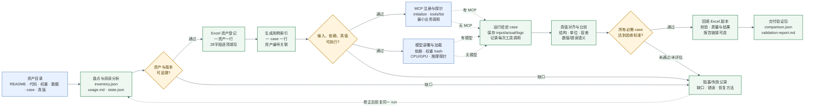

# 科学数字资产验证 Skill 使用方法

提供要验证的资产目录，并明确要求使用本目录的 `SKILL.md` 即可。无需先安装为全局 skill，可直接让智能体读取文件执行。

## 自动部署验证 Pipeline

下图是从资产目录到最终报告的完整自动化流程。实线表示主流程，虚线表示按资产类型选择的执行分支；每个菱形是门禁，未通过时保留证据并进入 `blocked/failed` 状态，不把失败伪装成通过。

流程中的两个分支可以独立完成：只有 MCP 的资产执行注册和工具调用，只有模型的资产执行加载和推理；两者都存在时，case 必须验证真实的 MCP/模型链路。数据集、环境或只读 skill 没有部署分支时标记 `not_applicable`，仍然必须登记并运行适用的可读性、schema 或工作流 case。

每一阶段都写入同一个 `run_id`：盘点产物进入 `inventory.json`，部署信息进入 `deployment/`，实际执行进入 `actual/` 与 `responses/`，比较结果进入 `comparison.json`，最终由 `validation-report.md` 汇总。Excel 是登记与回填视图，不能替代这些原始证据。

## 使用方式

向智能体提供本 skill 的 SKILL.md 路径、原始资产目录和执行范围。Excel 模板、case、真值已在资产目录内时可自动发现；存在多个候选时指定目标。需要平台注册或部署时，补充目标客户端、平台或运行环境。

支持完整流程、仅分析与填表、复用部署后验证，以及恢复已有运行。仅填表时直接概括适用验证报告中的结果，详细来源保存在证据文件中。恢复时提供已有 run 目录，读取 state.json 并核对版本及协议后继续。

中间结果和最终产物统一保存在原始资产目录下的 `asset-runs/<run_id>/`。每次新运行使用独立目录，盘点时排除已有 asset-runs。

## 会生成哪些结果

完整流程默认在 `<资产根目录>/asset-runs/<run_id>/` 保存：

| 文件或目录 | 内容 |
|---|---|
| `inventory.json` | 资产清单、类型、版本、来源及证据 |
| `usage.md` | 资产使用方法、输入输出、依赖及入口 |
| `state.json` | 各阶段状态及恢复信息 |
| `registration/科学数字资产清单.xlsx` | 登记表副本，含资产明细与用例明细 |
| `registration/asset-row-map.json` | 每个资产与 Excel 行、case 的对应关系 |
| `registration/field-evidence.json` | 各字段的填写依据与待补项 |
| `deployment/` | 部署配置、环境和调用检查记录 |
| `cases.json` | 用例清单、真值来源和比较协议 |
| `actual/`、`responses/` | 本次实际输出及完整工具调用记录 |
| `comparison.json` | 逐 case、逐字段的比较结果 |
| `validation-report.md` | 简洁的中文结果对比报告：本次输出 vs expected output |

具体产物取决于执行范围。原始 Excel 保留，填写输出副本。一个资产有多个 case 时，资产明细仍只占一行；每个 case 在用例明细单独占一行。缺 case、缺真值或未运行的资产也必须登记；填表结论依据适用报告，无验证依据时标记未验证。

完成 Excel 不等于已在平台注册；部署配置生成不等于服务已可用；运行状态记录在对应产物中。登记表可引用已有验证报告；新验证报告说明实际运行结果与 expected output 的对比。

## 详细规范

- [完整工作流](SKILL.md)
- [Excel 28 个字段与用例填写规则](references/registration.md)
- [逐列填写示例与常见错误](references/registration-examples.md)
- [比较规则与验证报告](references/validation.md)
- [资产发现与入口确认](references/local-assets.md)
