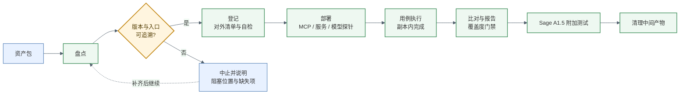

# sci-asset-verify-skill

用于科学数字资产交付前的自查。资产包提交前，使用本 skill 完成一次完整核验，确认资产可用、清单合规、结果与期望值一致，并在交付环节之前修正不符合项。

## 用途

资产提交后，接收方将依据对外发版口径逐项核验。清单字段不完整、用例覆盖不足、结果与期望值不一致，均会导致交付被退回，并额外产生一轮沟通与整改。

本 skill 将上述核验要求前置到提供方一侧：采用与接收方一致的内置标准与判定规则，执行完整核验流程，产出可直接随包提交的资产清单与验证报告，减少交付环节的返工。

## 使用方法

本 skill 无需安装。将本目录置于 agent 可读取的位置并指定使用本 skill，或将 `SKILL.md` 路径提供给 agent，由其按其中步骤执行。

执行前需明确核验对象与核验范围，例如：

```
用 sci-asset-verify-skill 自查 /data/delivery/some-package-2.1.0/ 这个包，
全量跑一遍，清单按对外发版口径填，交付前我想知道还有哪些项没过。
```

可根据进度调整范围：

- 材料尚未齐备，仅需确认缺口：「只做盘点和填表，先别跑用例」
- 服务已部署，仅需补跑用例：「跳过部署，直接用 http://xxx 那个服务」
- 上次执行中断：「接着 `asset-runs/run-YYYYMMDD` 那次继续」

资产涉及大模型调用且需进行 Sage A1.5 兼容性验证时，应提供 `SAGE_BASE_URL`、`SAGE_MODEL`、`SAGE_API_KEY`。未提供时，agent 将暂停并向用户索取，不会跳过该环节。

核验完成后，资产目录下生成 `asset-runs/<run_id>/`。其中以下三项为主要交付物：

- `validation-report.md`：核验结论，含通过项、未通过项及原因
- `registration/科学数字资产清单.xlsx`：可直接随包提交的资产清单
- `comparison.json`：逐条用例的期望值与实际值

其余文件为过程记录，供接收方复核时查阅。

## 检查范围

核验按六个阶段执行，每个阶段对应一类不符合项。

阶段一为资产盘点与使用说明。核查版本、入口、依赖、输入输出是否完整可追溯，常见问题包括目录名与版本号不一致、入口脚本缺失、依赖未声明。

阶段二为资产登记。按对外清单 23 列填写，表头、枚举、必填项、版本格式、一资产一行、用例引用可解析性均由脚本校验。使用内部字段口径、枚举值不在词表内、两行名称与版本重复等情况将直接报错。

阶段三为部署核验。存在 MCP 时完成注册并执行一次最小业务调用；存在模型时完成加载并执行一次推理。仅提供配置文件而服务不可用的情况不予通过。

阶段四为用例执行。使用资产包给定的用例逐条执行，记录输入、实际输出、退出码与耗时。用例缺失、期望值缺失、预期失败用例未按约定报错，均予以记录。

阶段五为比对与报告。逐项比对期望值，并按各类资产的用例数量下限核对覆盖度。通过率未注明分母、覆盖度不足却宣称完成的，将在报告中明确指出。

阶段六为 Sage A1.5 附加测试，仅针对涉及大模型调用的资产。切换后端执行后单独成节，不影响交付结论。

核验结束后自动清理中间产物，仅保留报告类证据，随包提交的目录不会因执行核验而增大。

## 结论判读

用例状态分为四种：通过、失败、未判定、不适用。

未判定指缺少期望值或判定阈值，仅给出差值而不给出结论。不适用分两种情形：资产包内本不存在该类资产，属合规跳过；或本 skill 无对应验收步骤，属能力缺口，报告中标注「未覆盖」，交付前应与接收方确认处理方式。

判定遵循以下规则：

- 每个资产在清单中仅占一行，用例不额外占用资产行
- 通过率注明分母，例如「27/27」；未执行项单独列出，不计入分母
- 某类资产用例数低于下限时，报告标注「覆盖不足」
- 资产包内缺失的描述文件不由本 skill 补写
- Sage 附加测试结果仅说明后端切换后的可用性，不计入交付结论

## 依赖说明

资产清单生成依赖 openpyxl，已随本 skill 置于 `vendor/` 目录，纯 Python 实现，MIT 许可，无需另行安装。运行时按以下顺序解析：当前环境已安装的版本、`vendor/` 内置版本、自动安装；三者均不可用时终止并输出修复命令。可在离线环境与干净容器中直接执行。如需固定依赖行为，可设置 `ACI_ASSET_VERIFY_AUTO_INSTALL=0`。

## 执行流程



各阶段均产出机器可读回执。执行中断时保留现场并记录原因，不清理既有结果。

## 测试与验证环境

本 skill 已在下列环境完成完整流程测试，各项检查全部通过。

| 项目 | 环境 |
|---|---|
| 操作系统 | Linux x86_64，24 核 CPU，无 GPU |
| 运行时 | Python 3.12 |
| agent | DeepSeek Harness（DSH），Web 会话 |
| 驱动模型 | DeepSeek-V4.1-Flash-1017（DS-4.1） |

测试内容如下。

一、脚本自测。`tests/selftest.py` 覆盖全部十一个脚本，共 63 项断言，含正例与负例，全部通过。该套件不依赖真实资产包、不需要网络，执行时间约 3 秒。断言校验至具体报错字段与提示文案，不以退出码作为唯一依据。

```
python tests/selftest.py
```

二、完整流程验证。在数据、工具、工作流三类交付包上执行完整六阶段流程，159 条用例与判据全部完成判定，无遗留项；覆盖度门禁各类型均达标；数据侧逐文件核验 327 个实体、534,694 行记录，与声明不符 0 处。

三、附加测试路径验证。涉及大模型调用的资产已完成 Sage A1.5 附加测试，15 组用例通过 8 组。失败集中在问答与报告正文生成环节，原因在于被核验资产所依赖的后端服务，按既定规则不计入交付结论。

## 仓库结构

```
SKILL.md           六阶段流程的完整作业手册，agent 按此执行
references/        登记字段口径与示例、比较规则与报告格式、资产发现方法
scripts/           十一个自检脚本
assets/            内置标准：23 列清单 schema、包络 JSON Schema、用例数量下限
tests/selftest.py  脚本自测套件
vendor/            随包分发的 openpyxl
```

## 版本记录

### 1.2-beta.6 — 2026-11-13

三个包并行核验时暴露的两处适配问题。

- 实体体积兼容 `bytes` / `size` 别名：规范字段是 `size_bytes`，但实际交付里有包写成 `bytes`，此前会**静默跳过体积核对**（只核了 sha256）。现在等价处理并提示改用规范字段
- `work_copy.py init` 不再被「SHA256SUMS 混入 `asset-runs/` 条目」判死：副本核验时剔除这类条目并记录 `excluded_asset_runs` 与整改建议（此前遇到这种包会建副本失败、删副本并退出 1，两个 3.1.2 包都是这个情况）
- 自测 60 → **63 项断言**（bytes 别名命中/不符、SHA256SUMS 混入 run 产物时 init 仍通过）

### 1.2-beta.5 — 2026-11-13

报告的问题清单固定三级，且"没问题"也要明说。

- 问题清单统一按 **P0 阻断 / P1 重要 / P2 建议** 罗列，每条带编号（`P0-1`…）、问题与证据、影响或整改要求；某一级为空写「无」，三级全空写「未发现问题」
- 新增 `scripts/check_report.py`：缺「问题清单」小节、缺分级标注、三级全空却未写「未发现问题」，都直接报错；编号与级别不匹配、缺版本/证据小节给告警；`--strict` 下告警也算失败
- `SKILL.md` 第 5 步与 `references/validation.md` 补上模板与判据（P0＝不可计为有效交付、P1＝规范强制要求不符、P2＝可改进）
- 自测 55 → **60 项断言**（三级齐全通过、未发现问题通过、不分级被拒、整节缺失被拒、三级全空被拒）

### 1.2-beta.4 — 2026-11-13

校验过程本身可追溯：报告与每份证据 JSON 都写明用的是哪个版本的校验 skill。

- 新增 `VERSION` 文件作为版本唯一来源；`scripts/_version.py` 统一读取（有 git 时同时取提交号，无 git 时记 `unknown`）
- 所有生产者脚本产出的 JSON（`envelope-report.json`、`asset-ids.json`、`check-list-report.json`、`coverage.json`、`work-copy.json`、`evidence-prune.json`、`sage-*.json`、`external-refs` 报告）都带 `skill: {name, version, commit, version_source}`
- 新增 `scripts/stamp_report.py`：把「校验工具版本」小节写到 `validation-report.md` **末尾**（幂等标记块），并给 run 内所有 dict 型证据 JSON 补齐 `skill` 字段（`cases.json`/`comparison.json`/`state.json` 等由执行方整理的台账靠它补）
- 报告完成条件增加「含校验工具版本小节」
- 自测 49 → **55 项断言**（VERSION 单一来源、两个生产者 JSON 打戳、报告末尾小节、幂等）

### 1.2-beta.3 — 2026-11-13

修 `prune_evidence.py` 在真实台账上的崩溃（校验 sample_skills 时暴露）。

- `cases.json` 里 `actual_output` 是**列表**（规范允许）时，台账标记按字符串处理会抛 `AttributeError`，而且发生在文件已删除之后 → 中间产出被真删、却没有 `evidence-prune.json`、没有 `actual_pruned` 标记、报告里也没有证据保留小节
- 修复：`actual_output`/`actual_path` 统一归一化为字符串列表再匹配；台账标记失败不再中断落盘（错误写进 `ledger_mark_error` 并告警）
- 顺带修两处：`--dry-run` 的 `bytes_after` 改为按“删完剩多少”预估；证据文件兜底不再硬写「用例执行报告」，改为按 run 内实际文件探测
- `asset_ids.py` 在 `--inject` 时若有资产拿不到资产ID，改为退出码 1（此前静默返回 0）
- 修 `task_classes` 漏检：原先「skill/task/trajectory/benchmark 至少一个任务概念」这条规则写在 `isinstance(task_classes, list)` 里，字段整个缺失时被跳过（真实案例：heritability 的 `asset.json` 没有该字段却判通过）
- **`jsonschema` 也随包分发**（`vendor/`，含 5 个依赖，均 MIT）：包络的 schema 交叉校验不再依赖环境是否装了这个包；解析顺序「环境 → vendor → 内置轻量实现」，报告里标注实际用的引擎
- 自测 45 → **49 项断言**（列表型 `actual_output` 的台账标记、dry-run 体积预估、skill 缺/空 task_classes）

### 1.2-beta.2 — 2026-11-13

包络校验收紧，Sage 需求判定改为证据驱动。

- `validate_envelope.py` 新增实体核对：本地 `spec.artifacts[].uri` 必须真实可达（支持百分号编码路径、容忍向上 1–3 级命中并告警）；声明了 `size_bytes` 逐字节比对；声明了 `sha256` 且体积 ≤64MB 的实测摘要（大文件只提示，`--hash-max-mb` 可调），`--no-artifact-files` 可关闭
- schema 交叉校验不再静默跳过：环境有 `jsonschema` 就用它，没有则回退内置轻量实现（覆盖 type/required/properties/items/minItems/minLength/pattern/enum/const/allOf/anyOf），报告里如实标注用的是哪个引擎
- `sage_probe.py detect` 改为**递归**读取子目录 `asset.json`；资产类型只作提示，是否需要在 Sage 上测只由「包内是否出现大模型 API 配置/调用证据」决定；新增 `--assume-llm` 供人工强制
- 自测扩到 **45 项断言**（实体缺失、摘要不符、schema 引擎标签、detect 递归与强制开关）

### 1.2-beta.1 — 2026-11-12

清单精简与外部资产引用支持。

- 对外清单由 25 列精简为 **23 列**，移除「联系人」「项目负责人」两列，对接人与责任归属改由项目台账维护；「资产关联」仍为末列
- 新增可选文件 `external_assets.json`（任务包根目录），用于声明包内未随附、需平台按资产编号解析的外部资产
- 新增 `scripts/external_refs.py`：校验该文件的 schema_version、asset_id 四段格式、asset_version、target_path（相对 POSIX 路径、不得越出包根）、重复引用；通过后自动把引用明细写入清单「资产关联」列；文件不存在时合规跳过
- 新增内置标准 `assets/external-assets.schema.json`（schema_version + assets[]，不含 task_id）
- `check_list` 增加「资产关联」列内资产编号的格式校验
- 自测套件扩到 **40 项断言**（新增外部引用正例与四类负例）

### 1.0-beta.2 — 2026-11-10

跟进规范 v1.1：明确资产编号规范，清单增加「资产ID」列。

- 包络 `asset_id` 校验改为四段格式 `sciasset://{project-id}/{namespace}/{asset-type}/{slug}`，三段旧格式直接报错并提示补 project-id
- 新增 `scripts/asset_ids.py`：从包络生成清单「资产ID」（`asset_id` 去掉 `sciasset://` 前缀，不含版本号），支持 `--inject` 写回 rows.json、`--check` 校验
- 清单 schema 由 24 列扩为 25 列，资产ID 列为首列且必填；`check_list` 校验其格式、不得含版本号、类型段与「资产类型」列一致
- 行标识改为「资产ID + 版本」
- 修复 `check_coverage` 只认三段 asset_id、导致四段格式无法归类的问题
- 自测套件扩到 34 项断言（新增四段格式、带版本号、清单资产ID 拼接与写回等）

### 1.0-beta.1 — 2026-11-09

首个可用版本，由纯文档作业手册升级为可执行的核验工具链。

- 内置三份标准：对外清单 23 列 schema、资产包络 JSON Schema、各类资产用例数量下限
- 七个脚本：包络校验、清单生成与复检、覆盖度门禁、副本管理与完整性自检、证据清理、Sage 探测
- 自测套件 27 项断言，不依赖真实资产包
- 新增第六阶段 Sage A1.5 附加测试，结果不计入交付结论；配置缺失时中止并索取，不作跳过
- openpyxl 随包分发，缺失时自动安装作为兜底
- 判定口径：一资产一行、通过率注明分母、覆盖不足明确标注、不适用情形分类记录
- 完成三类交付包的完整流程验证

版本号说明：`1.0-beta.1` 合并了开发期的两轮改动（可执行化、依赖自包含），对外仅发布此版本。

### 1.0-alpha.1 — 2026-11-04

初版，仅含文档：五阶段流程（盘点、登记、部署、用例执行、报告），`references/` 四篇（28 字段登记规则、逐列示例、比较规则、资产发现），无脚本与内置标准，判定依赖人工执行。

## 相关文档

- [完整作业手册（SKILL.md）](SKILL.md)
- [对外清单 23 个字段与用例填写规则](references/registration.md)
- [逐列填写示例与常见错误](references/registration-examples.md)
- [比较规则、覆盖下限与验证报告格式](references/validation.md)
- [资产发现与入口确认](references/local-assets.md)

## 维护

Knowledge Frontier Team，上海人工智能实验室。仓库：`KnowledgeXLab/sci-asset-verify-skill`。

脚本变更后应先执行 `python tests/selftest.py`，63 项断言全部通过方可提交。版本号遵循：口径发生破坏性变更时递增次版本号，仅文档或脚本修补时递增修订号；发布时同步更新 tag 与本文档的版本记录。
