# sci-asset-verify-skill

用于科学数字资产交付前的自查。资产包提交前，使用本 skill 完成一次完整核验，确认资产可用、清单合规、结果与期望值一致，并在交付环节之前修正不符合项。

## 用途

资产提交后，接收方将依据对外发版口径逐项核验。清单字段不完整、用例覆盖不足、结果与期望值不一致，均会导致交付被退回，并额外产生一轮沟通与整改。

本 skill 将上述核验要求前置到提供方一侧：采用与接收方一致的内置标准与判定规则，执行完整核验流程，产出可直接随包提交的资产清单与验证报告，减少交付环节的返工。

## 安装

本 skill 是**一个目录**，装到 agent 能读到的 skills 位置即可。推荐用 git 安装（这样才能用上"开跑自动对齐最新版"）。

### 0. 系统环境要求

| 项 | 要求 |
|---|---|
| Python | ≥ 3.10（仅标准库 + 随包 `vendor/`） |
| git | 仅"安装/自动更新"需要；离线拷贝安装可不要 |
| 网络 | 自动更新、`--check` 需要能访问 GitHub；核验本身不需要联网 |
| 第三方依赖 | 无（`vendor/openpyxl`、`vendor/jsonschema` 已内嵌） |
| Harness | Deepseek Harness / Claude Code / Codex / OpenCode / Kimi Code / Qwen Code / ZCode |
| 附加配置 | SAGE_BASE_URL/SAGE_API_KEY，用于 Sage A1.5 兼容性测试 |

#### 依赖说明

执行校验所必须的依赖库已随本 skill 置于 `vendor/` 目录，纯 Python 实现，MIT 许可，无需另行安装。运行时按以下顺序解析：当前环境已安装的版本、`vendor/` 内置版本、自动安装；三者均不可用时终止并输出修复命令。可在离线环境与干净容器中直接执行。


### 1. 用 git 安装（推荐）

Deepseek Harness：clone 到工作区的 .dsh/skills/ 或用户级 skills 目录

```bash
SKILL_DIR="<workspace-or-user-home>/.dsh/skills"
mkdir -p $SKILL_DIR
git clone --depth 1 https://github.com/KnowledgeXLab/sci-asset-verify-skill.git \
    "$SKILL_DIR/sci-asset-verify-skill"
```

其他 harness（Claude Code / Codex 等）：clone 到相应的 skills 目录即可，技能说明在 `SKILL.md`。

#### 自动更新

通过 clone 方式安装的 skill 支持在每次核验开始时自动检查并拉取仓库中的最新 tag（工作区有未提交改动时拒绝更新，不覆盖本地修改）。但是需要留意 agent 是否具有 skill 安装目录的写权限：

| 安装位置 | 自动更新 | 说明 |
|---|---|---|
| **工作区** | ✅ 可用 | 在会话工作区内，`workspace-write` 沙箱即可写 |
| **用户级** | ⚠️ 视权限 | 会话若只允许写工作区（`workspace-write`），`git checkout` 会被拒；此时脚本报 `无写权限，跳过自动更新`，需放宽权限或手动 pull |

要强制关闭自动更新，可指定环境变量 `ASSET_VERIFY_NO_UPDATE=1`。要手动更新，可执行以下命令：

```bash
python3 scripts/update_skill.py --apply        # 切到远端最新 tag，并自动跑一次自测
python3 scripts/update_skill.py --apply --no-update   # 本次不更新
```

### 2. 离线 / 无 git 的安装方式

下载并解压到 skills 位置也可使用（依赖已随 `vendor/` 打包，无网络也能跑），但**自动更新不可用**——`update_skill.py` 会提示"非 git 安装，请手动下载最新版"。

### 3. 验证安装

```bash
cd "<path/to/sci-asset-verify-skill>"
cat VERSION                                  # 打印当前版本
python3 tests/selftest.py                    # 自测：应显示「自测结果：N/N 通过」
python3 scripts/update_skill.py --check      # 与远端最新 tag 比对
python3 scripts/validate_envelope.py --help  # 任一脚本能跑即说明依赖就绪
```

## 使用方法

直接在 Harness 中提示 agent 使用本 skill 即可；也可把 `SKILL.md` 路径提供给 agent，由其按其中步骤执行。执行前需明确核验对象与核验范围，推荐的提示词如下：

```
用 sci-asset-verify-skill 自查 /data/delivery/some-package-2.1.0/ 这个包，
全量跑一遍，清单按对外发版口径填，交付前我想知道还有哪些项没过。
```

可根据进度调整范围：

- 材料尚未齐备，仅需确认缺口：「只做盘点和填表，先别跑用例」
- 服务已部署，仅需补跑用例：「跳过部署，直接用 http://xxx 那个服务」
- 上次执行中断：「接着 `asset-runs/run-20261114-105545` 那次继续」

资产涉及大模型调用且需进行 Sage A1.5 兼容性验证时，应提供 `SAGE_BASE_URL`、`SAGE_API_KEY`。未提供时，agent 将暂停并向用户索取，不会跳过该环节。

核验完成后，资产目录下生成 `asset-runs/run-[YYYYMMDD]-[hhmmss]/`（批次目录名固定为「日期-时分秒」，便于按时间追溯）。其中以下三项为主要交付物：

- `validation-report.md`：核验结论，含通过项、未通过项及原因
- `registration/科学数字资产清单.xlsx`：可直接随包提交的资产清单
- `comparison.json`：逐条用例的期望值与实际值

其余文件为过程记录，供接收方复核时查阅。

## 核验结论判读

### 1. 检查范围

包含六个**检查内容维度**：

1. 资产盘点与使用说明：核查版本、入口、依赖、输入输出是否完整可追溯，常见问题包括目录名与版本号不一致、入口脚本缺失、依赖未声明；
2. 资产登记：按对外清单 23 列填写，表头、枚举、必填项、版本格式、一资产一行、用例引用可解析性均由脚本校验。枚举值不在词表内、两行名称与版本重复等情况将直接报错；
3. 部署核验：存在 MCP 时完成注册并执行一次最小业务调用；存在模型时完成加载并执行一次推理。仅提供配置文件而服务不可用的情况不予通过；
4. 用例执行：使用资产包给定的用例逐条执行，记录输入、实际输出、退出码与耗时。用例缺失、期望值缺失、预期失败用例未按约定报错，均予以记录；
5. 比对与报告：逐项比对期望值，并按各类资产的用例数量下限核对覆盖度。通过率未注明分母、覆盖度不足却宣称完成的，将在报告中明确指出；
6. Sage A1.5 兼容性测试（仅针对涉及大模型调用的资产）：切换后端执行后单独成节，不影响交付结论。

### 2. 结论判读

**唯一验收来源是批次目录里的 `validation-report.md`**；登记表、清单、聊天记录里的说法都不构成验收结论，
只能转述该报告与 `comparison.json` 的内容。

#### 先看结论

报告第 1 节只给三种之一：

| 结论 | 含义 |
|---|---|
| **通过** | 所有给定用例执行且与 expected output 一致，无未判定项 |
| **不通过** | 存在 P0，或给定用例与 expected output 不一致 |
| **未判定** | 缺 expected output / 阈值 / 用例无法执行，**不等于通过** |

同时核对三件事：**通过率的分母**（planned/executed/passed 分别是多少）、**覆盖表**（任何类型的用例数低于下限，
报告必须写「覆盖不足」，不得宣称闭环完成）、**未执行项**（`blocked`/`skipped`/`not_evaluated` 必须逐条写明原因）。

#### 再看问题分级

问题清单固定三级，每条都带**编号**、**归属**（哪个资产目录，或「包级」）、证据与整改要求：

| 级别 | 含义 | 处置 |
|---|---|---|
| **P0 阻断** | 不可计为有效交付 | 必须修完重交：包结构/包络不合规、声明的实体缺失或摘要不符、无可用验证入口或用例结论不通过、包内出现凭据/明文密钥、需要 Sage 却未跑通、harbor 任务包缺必需文件或 oracle/nop 不达标 |
| **P1 重要** | 规范强制要求不符，影响复现或验收 | 建议整改后重交：文档引用指向不存在的文件、版本口径不一致、声明与实体不符、文档事实/算术错误、验证说明与用例不一致、覆盖不足 |
| **P2 建议** | 可改进，不构成违规 | 由交付方自行取舍，不影响结论 |

要点：

- **P0/P1 只能来自 `probe-report.json` 的 `check_id`**，判定级别写死在 `assets/audit-checks.json` 里，执行者不得升降级；
  P2 不限制来源，清单外的观察也写进 P2
- **P0 只认资产自带用例/门槛的结论**；核验方补建的用例即使发现问题，最高只算 P1
- 有些情况**明确不判**（写了反而是噪音）：`governance` 取值、包根一级文件内容、`spec.asset_protocol` 字段、
  `lifecycle=draft`、资产内部实现风格、示例包里的占位编号/单位等，详见 [references/validation.md](references/validation.md)

#### 资产可交付标准

| 判定 | 条件 |
|---|---|
| **可交付** | `P0 = 0`，且覆盖度达标（各类用例数不低于 `assets/case-minimums.json` 下限），且没有未说明的未执行项 |
| **不可交付** | 出现任一 P0，或用例与 expected output 不一致，或覆盖不足却宣称完成 |
| **附条件交付** | `P0 = 0` 但存在 P1：按 P1 清单整改后重交；P2 仅作建议 |

Sage A1.5 兼容性测试是**附加项**，单独成节，不计入上述交付判定；但需要 Sage 却因配置缺失未跑通时，
按 `P0-SAGE` 阻断交付（不允许以「未测」结案）。

#### 可复现性

同一份包 + 同一版 skill + 同一用途（`--intent`）⇒ 同一结论。报告的 front matter 记录了 `skill_version`/`skill_commit`，
`probe-report.json` 记录了 `probe_fingerprint`：**指纹相同而结论不同，说明执行偏离，不是资产变了**，应重跑而不是改判。

## 执行流程

分两块看：**先看主流程**（主进程，秒级；不通过就直接终止，不烧核验时间），
**再看「执行核验」的展开**（子进程按固定合同执行，分三步）。

**实线框＝脚本自动执行（框内是脚本名）；紫色虚线框＝AI 自主执行，没有对应脚本；橙色＝人工。**

### 1. 主流程（主进程）

```mermaid
%%{init: {"theme": "base", "themeVariables": {"fontSize": "13px", "lineColor": "#52606d"}}}%%
flowchart LR
    A["版本检查<br/>update_skill.py"] --> B["静态预审<br/>preflight.py + probe --static-only"] --> C["建批次 + 状态机<br/>verify_entry.py"] --> D["建副本<br/>work_copy.py"] --> E["外部资产<br/>external_refs / mount_external"] --> F["副本可信性检查 + 台账<br/>probe / build_inventory"]

    classDef script fill:#f8fafc,stroke:#94a3b8,stroke-width:1.5px;
    classDef human fill:#fff7ed,stroke:#f97316,stroke-width:1.5px;
    classDef focus fill:#e8f1ff,stroke:#3569a8,stroke-width:2px;
    class A,B,C script;
    class D focus;
    class E human;
```



1. 版本检查（`scripts/update_skill.py`）
    | 情况 | 行为 |
    |---|---|
    | 已是最新 | 记录 `skill-update.json`，继续 |
    | 有新版 + 能自动更新（git、干净、可写、非开发分支） | 提示可跑 `scripts/update_skill.py --apply`，本次仍按当前版本核验 |
    | **有新版 + 不能自动完成**（非 git 安装 / 无写权限 / 工作区脏 / 开发分支） | **终止**并提示「发现新版本 X（当前 Y），但当前安装方式/权限不支持自动更新，请手动更新 skill 后重试」 |
2. 快速预审（`scripts/preflight.py`）
    | 层 | 检查 | 级别 |
    |---|---|---|
    | 环境 | Python ≥3.9、skill 文件完整、**至少一个可用 harness** | 阻断 |
    | 环境 | docker / harbor CLI 缺失、Sage-A1.5 未配置 | 提示 |
    | 格式 | 包根不得有 `asset.json`、一级子目录必须是资产目录、`asset.json` 可解析且必需字段齐全、`asset_type` 属八类、`asset_id` 四段式（`sciasset://<项目编号>/<命名空间>/<类型>/<名称>`）、`asset_id` 不重复 | 阻断 |
    | 格式 | `validate/`、`cases.json` 缺失 | 提示 |

    若命中任一**阻断**项，则跳过后续核验流程，直接打印问题清单并退出（退出码 1=包问题 / 2=环境问题）。
3. 执行核验：拉起独立进程，把固定合同交给 agent 执行（见下节）。

### 2. 执行核验展开（子进程按固定合同执行）

1. 机检 + 判定内核（脚本）
    ```mermaid
    %%{init: {"theme": "base", "themeVariables": {"fontSize": "13px", "lineColor": "#52606d"}}}%%
    flowchart LR
        D0["选适配器 + bash -ic<br/>harnesses/*.py"] --> S1["probe_package.py<br/>validate_envelope.py<br/>check_selfcontained.py"] --> K["probe_package.py --evaluate<br/>16 项 → P0 8 / P1 8"]

        classDef script fill:#f8fafc,stroke:#94a3b8,stroke-width:1.5px;
        class D0,S1,K script;
    ```
2. 跑用例（AI 调度 + 脚本）
    ```mermaid
    %%{init: {"theme": "base", "themeVariables": {"fontSize": "13px", "lineColor": "#52606d"}}}%%
    flowchart LR
        S2["AI 产出产物 → run_cases.py（≤8 并发）<br/>每资产分片，按 case_id 排序合并"] --> S2b["harbor_run.py（串行）<br/>sage_probe.py（串行）<br/>部署核验 model/environment"]

        classDef script fill:#f8fafc,stroke:#94a3b8,stroke-width:1.5px;
        classDef ai fill:#f5f3ff,stroke:#8b5cf6,stroke-width:1.5px,stroke-dasharray:4 3;
        class S2 ai;
        class S2b script;
    ```
3. 报告与复核（AI 写报告 + 脚本复核，不通过就回写）
    ```mermaid
    %%{init: {"theme": "base", "themeVariables": {"fontSize": "13px", "lineColor": "#52606d"}}}%%
    flowchart LR
        S3["AI 自主执行<br/>写 validation-report.md"] --> S3b["check_coverage.py<br/>check_report.py"] --> G{"两关都 error 0?"} --> OUT["回传摘要<br/>verify_entry.py"]
        G -- 否 --> S3

        classDef script fill:#f8fafc,stroke:#94a3b8,stroke-width:1.5px;
        classDef ai fill:#f5f3ff,stroke:#8b5cf6,stroke-width:1.5px,stroke-dasharray:4 3;
        class S3 ai;
        class S3b,G,OUT script;
    ```

### 3. 各步骤的关联执行体
| 步骤 | 执行体 | 脚本 / 说明 |
|---|---|---|
| 版本检查 | 脚本 | `update_skill.py`（`git ls-remote --tags`，有新版且不能自动更新则终止） |
| 快速预审 | 脚本 | `preflight.py`（环境 + 包格式，内部调 `validate_envelope.py`） |
| 执行核验 | 脚本起进程 | `verify_entry.py --isolated` + `harnesses/*.py`（适配器）+ `run_skill_agent.py`（DSH_HOME 隔离与清理） |
| -- 机检 | 脚本 ×3 | `probe_package.py`、`validate_envelope.py`、`check_selfcontained.py` |
| -- 判定内核 | 脚本 | `probe_package.py --evaluate`（P0/P1 全部由它给出，AI 不得升降级） |
| -- 跑用例 | **AI** + 资产脚本 | AI 逐条调资产自带 `validate/validate.py`、算 expected/actual 偏差并汇总 `cases.json` / `comparison.json` |
| -- harbor / Sage | 脚本 | `harbor_run.py`、`sage_probe.py detect/probe` |
| -- 写报告 | **AI** | 无脚本；结论必须能对回 `probe-report.json` 的 `check_id` |
| -- 复核 | 脚本 ×2 | `check_coverage.py`（用例下限）、`check_report.py`（分级/归属/竖线/跨批次措辞） |
| 摘要 / 归档 | 脚本 + 人工 | `verify_entry.py` 输出摘要；批次留 `asset-runs/run-<ts>/` 供复核 |

每一步的真实输出都落在批次目录里，报告只引用本批次落盘事实，不引用历史会话或既有 `asset-runs/` 结论。

## Harness 支持

目前已实现以下 harness 的支持，默认优先级如下：

`dsh` → `codex` → `claude` → `opencode` → `kimi` → `qwen` → `zcode` → `cursor`

核验入口默认按优先级自动检测和调起宿主机上已经安装的 harness，使用该 harness 的默认端点和模型配置执行核验流程。也可以通过参数 `--harness <harness>` 指定要调用的 harness。

优先级写在每个适配器的 `priority=` 字段（`scripts/harnesses/*.py`），调一行即可改变排序。

## 测试与验证环境

除 `tests/selftest.py`（`191` 项断言，含正例与负例）外，还有一份**正向命中自检** `tests/probe_hits.py`：
为 `probe_package.py` 的每项检查各造一个**故意违规的合成包**，断言对应字段必须命中。

它防的不是覆盖率，而是**"检查永远不触发"的静默失效**——这类 bug 不会让测试变红，只会让报告漏问题。
已实测有效性：把 `absolute_symlinks` 判定手动关掉后，自检立刻报 `FAIL 越界：绝对路径软链`。


本 skill 已在下列环境完成完整流程测试，各项检查全部通过。

| 项目 | 环境 |
|---|---|
| 操作系统 | Linux x86_64，24 核 CPU，无 GPU |
| 运行时 | Python 3.12 |
| agent | DeepSeek Harness（DSH），Web 会话 |
| 驱动模型 | DeepSeek-V4.1-Flash-1017（DS-4.1） |

测试内容如下。

一、脚本自测。`tests/selftest.py` 覆盖全部二十个脚本，共 191 项断言，含正例与负例，全部通过。该套件不依赖真实资产包、不需要网络，执行时间约 3 秒。断言校验至具体报错字段与提示文案，不以退出码作为唯一依据。

```
python tests/selftest.py
```

二、完整流程验证。在数据、工具、工作流三类交付包上执行完整六阶段流程，159 条用例与判据全部完成判定，无遗留项；覆盖度门禁各类型均达标；数据侧逐文件核验 327 个实体、534,694 行记录，与声明不符 0 处。

三、附加测试路径验证。涉及大模型调用的资产已完成 Sage A1.5 附加测试，15 组用例通过 8 组。失败集中在问答与报告正文生成环节，原因在于被核验资产所依赖的后端服务，按既定规则不计入交付结论。

## 仓库结构

```
SKILL.md           六阶段流程的完整作业手册，agent 按此执行
references/        登记字段口径与示例、比较规则与报告格式、资产发现方法
scripts/           二十个自检脚本（另有 4 个内部模块）
assets/            内置标准：23 列清单 schema、包络 JSON Schema、用例数量下限
tests/selftest.py  脚本自测套件
vendor/            随包分发的依赖库
```

## 版本记录

> 当前开发版 `1.4-beta.1-dev`（未发版）：**跨 harness 统一入口**——`scripts/verify_entry.py` 把核验流程固化成
> 由 skill 生成的「执行合同」（`prompts/verify-task.md.tmpl` → `<run>/verify-task.md`），任何 agent 框架都照同一份合同跑；
> 结论仍由脚本门禁校验，不依赖模型自觉，也不要求对方支持子智能体。


> **Harbor 任务包支持**（合并 PR #1）：识别 task / 显式 dataset / 隐式 dataset 三种形态；静态检查入固定清单
> （`P0-HARB-STRUCT` 必需文件、`P0-HARB-RUN` oracle/nop 双 trial、`P1-HARB-DATASET`/`P1-HARB-ENVELOPE`/`P1-HARB-LINT`）；
> 执行走官方 CLI 全量 oracle+nop（`scripts/harbor_run.py`），跑不了记 blocked（不算 na 不算 fail）；task@harbor 不触发 Sage。

### 1.3-beta.1 — 2026-11-24

**Harbor 任务包校验（合并 PR #1）+ 四项误判修正**

- 新增 harbor / terminal-bench-science 格式支持：`scripts/_harbor.py`（形态识别、必需文件、任务 digest）、
  `scripts/harbor_run.py`（官方 CLI 跑 oracle+nop 双 trial，reward 结构化解析，环境不备记 blocked）
- 清单扩到 **P0×8 + P1×8 = 16 条**：`P0-HARB-STRUCT`/`P0-HARB-RUN`、`P1-HARB-DATASET`/`P1-HARB-ENVELOPE`/`P1-HARB-LINT`；
  原 PR 的 P2 项改为建议输出（清单不保留 P2 项）
- **修正 `P0-ENVELOPE` 假阴性**：探测按 `assets[]` 读而校验脚本输出 `results[]`，导致包络缺必填项也判 pass
- **修正 `P0-SECRET` 两处误报**：`task-01-without-knowledge` 被当成 `sk-` 密钥；`LLM_API_KEY=`（空值）跨行吃到下一行变量名
- **放宽 `P1-DOC-REF`**：剥掉 markdown 链接文字只认目标；token 在包内后缀唯一命中即视为存在；补产物目录与 skill 自带脚本路径
- `SKILL.md` 新增 2.6 节、`references/validation.md` 新增 harbor 用例口径；`case-minimums.json` 的 task 行改全量语义

- 自测 132 → **157 项断言**

### 1.2-beta.9 — 2026-11-20

**Sage 配置未就绪不再「只记未测」，改为阻断**

- 新增检查项 **`P0-SAGE`**（清单现为 **P0×6 + P1×5 = 11 条**）：需要 Sage 附加测试的资产
  （包内含 skill/agent 类资产即需要）若因环境变量/连通性等配置原因没跑通，且用户给不出可用配置 → 判 **P0**，
  须先完成配置（**API URL 与 API KEY 可在端砚平台（书生·Intern-Discovery）获取**）才能交付，不得以「未测」结案
- `probe_package.py` 新增 `--run-dir`：读 `sage-need.json` / `sage-config.json` / `sage-a1.5-report.json`，
  区分 `config_missing`（没配）/ `config_invalid`（配了但连不上、401/403）/ `not_run`（根本没用 Sage 跑）
- 索取配置的文案写清：只要在**环境变量**里设置 `SAGE_BASE_URL`/`SAGE_MODEL`/`SAGE_API_KEY`，
  不要把明文密钥贴进对话、写进文件或带进交付包
- `SKILL.md` 第 5 步固定带 `--run-dir` 跑判定；`check_report.py` 加守卫——需要 Sage 却没带 `--run-dir`
  （缺 `sage_profile`）或未跑通却没有 `P0-SAGE`，报告结构检查直接告警

- 自测 128 → **132 项断言**

### 1.2-beta.8 — 2026-11-19

**安全修复：核验过程不再把凭据落盘**

隔离 `DSH_HOME` 原先会把 `~/.dsh/.credentials.yaml` 复制进 run 目录，`asset-runs/` 随包外发即等于交付物含明文密钥。

- 隔离 `DSH_HOME` 只复制 profiles 与 node_modules 软链；**凭据在内存中解析** `*_API_KEY`
  （`AGENT_CENTER_API_KEY` / `DEEPSEEK_API_KEY` / `INKSTONE_API_KEY` …）后**经环境变量注入子进程**
- 新增 `scrub_secrets()`：每次运行结束（含异常分支）清理 `.credentials.yaml`、`.dsh-home-*`、
  `codex-home` / `claude-home` 及其 `auth.json`
- **新增检查项 `P0-SECRET`**（10 条清单里的第 5 条 P0）：包内出现凭据文件（`.credentials.yaml`、`auth.json`、
  带密钥的 `.env`）或明文密钥（`sk-…`、`Bearer …`、`*_API_KEY=<值>`）即**阻断交付**；
  扫描跳过 `asset-runs/`、`.asset-work/`、`node_modules/`、`vendor/`、`.tmp/`，避免插件示例文档误报

- 自测 125 → **128 项断言**

### 1.2-beta.7 — 2026-11-18

**四类误判修正（都来自真实包复核）**

- **容器内绝对路径不再判越界**：资产自身声明容器（`environment_type=docker`、`image`、`base_image`、自带
  `Dockerfile`/`compose.yaml`）或**同包存在声明了容器的 `environment` 资产**时，`/opt/…`、`/data/…` 记为 note；
  `/home/…`、`/Users/…`、`/root/…` 等宿主机路径仍判越界。结果里带 `container_context` 说明豁免依据
- **文档路径 token 不再被截断**：`image/x.tar.sha256` 曾被截成 `…tar.sh`、`a.shp` 曾被截成 `a.sh` 而误报缺失；
  扩展名改为必须落在文件名边界上。仅大小写不同的同名文件单独记 `case_only_mismatch`，不算缺失
- **`sage_probe.py detect` 支持 `catalog.json` 的路径数组**：`assets: ["x/asset.json", …]` 时不再
  `AttributeError`，逐条解析出资产类型
- **覆盖表 na 规则字段名修正**：`P1-VERIFY-DOC` 曾因读旧字段名而永远判 na（理由与事实相反），
  现在按实际 `cases_json` 判定；`validate/cases.json` 缺失时兜底取资产内任一 `cases.json`

- 自测 120 → **125 项断言**

### 1.2-beta.6 — 2026-11-17

**开跑自动对齐版本**

- 新增 `scripts/update_skill.py`：核验第一步检查远端最新 tag，有新版就 `git checkout` 过去，
  更新后自动跑一次自测；版本比较按语义序（`,alpha/beta/rc/正式`，`-dev` 后缀按同号处理）
- **不阻断核验**：非 git 安装、离线无 origin、工作区有未提交改动、目录不可写（如用户级安装但会话只能写工作区）
  → 一律打印状态并继续，`skill-update.json` 记录原因；`--no-update` / `ASSET_VERIFY_NO_UPDATE=1` 可关闭
- 报告 front matter 的 `skill_version`/`skill_commit` 自然反映更新后的版本；同一批核验内不中途切换

**README 新增「安装」章节**（在「使用方法」之前）：git 安装（可 `--branch` 钉版本）、验证安装、
更新方式、离线拷贝安装的限制，以及「装在哪里：权限与自动更新的取舍」（项目级可自动更新 / 用户级视会话权限）

- 自测 114 → **120 项断言**

### 1.2-beta.5 — 2026-11-17

**判定口径固定，结论可复现**

- P0×6 / P1×5 写死：P0 = 包结构、包络合规、资产完整性（含引用包外/绝对路径）、可执行验证入口与结论、不得含凭据/密钥（`P0-SECRET`）、Sage 附加测试未跑通（`P0-SAGE`）；
  P1 = 文档引用不存在、版本口径不一致、声明与实体/实现不符、文档事实或算术错误、验证说明与用例不一致
- `scripts/probe_package.py` 出**确定性事实**（同包多次运行指纹相同）+ `--evaluate` 按清单判级；
  报告须附 `pass/fail/na` 覆盖表，`na` 必须写理由
- 问题清单**每行必须写明归属**（资产目录名或「包级」），P0/P1 只能引用检查项 id，P2 为自由建议

**不校验（明确排除）**：`governance` 发布口径取值、包根一级文件（其问题一律丢弃，不降 P2）、`spec.asset_protocol`
字段内容、`lifecycle` 取值（`draft` 属正常交付状态）、挂载副本、`asset-runs/`

**其它**：包根出现 `asset.json` 判 `P0-STRUCT`（资产必须作为子目录存在）；文档引用检查只看脚本/文档类 token
并豁免产物目录；`check_report.py` 新增归属、包根文件、lifecycle、检查项引用四项守卫

### 1.2-beta.4 — 2026-11-16

- **外部资产挂载重做**：先在同包内按 `asset_id` 解析，包外才按优先级查找并复制进副本，最后按 `target_path` 建软链（父目录自动创建）；挂载进来的副本不计入本包校验，挂载缺失只报告不中断
- **skill 验收改造**：`validate/readme.md` 写清 Agent（harness + model）、怎么测（任务/输入/输出）、通过门槛；验收用 `run_skill_agent.py` 起**独立 CLI 进程**跑，内置 dsh/codex/claude/cursor/gemini/opencode/aider 预设，声明之外的 harness 就地固化；Sage 测试沿用同一 harness 只换后端（`SAGE_*`），门槛判 agent 产物
- **降噪与口径**：`asset_protocol` 不校验内容；`target_path` 本地缺失不告警；文档里的产物文件名不误判为路径；清单词表缺口（如「敏感级别」无「公开」档）不算缺陷；不参考包内已有核验结果、不做跨批次对比
- 自测 80 → **104 项断言**

### 1.2-beta.3 — 2026-11-14

- `external_assets.json` 从包根改为**每个资产目录**一份；「资产关联」列只填本资产声明的 `asset_id`（去前缀、逗号分隔、无则留空）
- 批次目录统一 `asset-runs/run-[YYYYMMDD]-[hhmmss]/`（`new_run.py` 生成，`work_copy.py` 校验）
- 报告的版本与生成时间改为文件头 YAML front matter，正文不再出现
- 自测 69 → 80 项断言

### 1.2-beta.2 — 2026-11-13

校验口径收紧、报告可追溯、依赖自包含。核心变化是**把"资产能不能独立入库"变成可校验项**。

**新增校验能力**
- **资产自包含校验**：新增 `scripts/check_selfcontained.py`——任何资产只能引用**自己目录内**的文件；唯一允许的外部引用方式是本资产目录下的 `external_assets.json` 按资产编号声明。越界区分「指向包内另一个资产」「指向包内共享位置」「指向包外本机路径」并给整改方向；文档里的路径只算提示。包络校验同步收紧：`spec.artifacts[].uri` 与 `spec.asset_protocol` 的本地路径越出资产目录即 error
- **实体核对**：`validate_envelope.py` 逐条核对 `spec.artifacts` 的实体是否存在、`size_bytes`（兼容 `bytes`/`size` 别名）与 `sha256`（≤64MB 实测，大文件只提示）是否一致
- 修复 `task_classes` 漏检：字段整体缺失时不再被跳过（skill/task/trajectory/benchmark 至少一个任务概念）
- schema 交叉校验不再可能静默跳过：环境无 `jsonschema` 时回退内置轻量实现，并如实标注所用引擎
- `sage_probe.py detect` 改为递归读取子目录 `asset.json`，资产类型只作提示、是否需 Sage 测试只由大模型 API 证据决定；新增 `--assume-llm` 人工强制

**报告**
- 问题清单固定三级：**P0 阻断 / P1 重要 / P2 建议**，每条带编号与证据；某级为空写「无」，三级全空写「未发现问题」；新增 `scripts/check_report.py` 自查
- **校验 skill 版本可追溯**：`VERSION` 文件为版本唯一来源，所有证据 JSON 带 `skill: {name, version, commit}`，报告末尾由 `scripts/stamp_report.py` 写入「校验工具版本」小节
- `asset_id` 类问题的整改要求必须照抄完整格式规范（`sciasset://{project-id}/{namespace}/{asset-type}/{slug}`，及 project-id/namespace/asset-type/slug 各自的含义）
- 写 md 时表格单元格内的竖线须转义成 `\|`（反引号内同样）

**依赖与产物约定**
- `jsonschema` 4.26.0 连同依赖一并 vendor，包络交叉校验不再依赖环境
- 按专项约定：**不核验、也不生成包根 `SHA256SUMS`**；完整性以文件数/字节数 + `asset.json` 声明的实体摘要为准
- 修复 `prune_evidence.py` 在 `actual_output` 为列表时的崩溃（此前会删了中间产物却没有清理记录）
- `SKILL.md` 增加「历史批次只增不改」：每批新建 `asset-runs/<run_id>/`，任何已有批次不得删除或覆盖

**验证**
- 自测 40 → **69 项断言**，覆盖四个真实包的核验（地球科学数据/工具/工作流、生物育种 sample_skills）


### 1.2-beta.1 — 2026-11-12

清单精简与外部资产引用支持。

- 对外清单由 25 列精简为 **23 列**，移除「联系人」「项目负责人」两列，对接人与责任归属改由项目台账维护；「资产关联」仍为末列
- 新增可选文件 `external_assets.json`（当时定义在**包根目录**；`1.2-beta.3` 起改为**每个资产目录**各一份），用于声明包内未随附、需平台按资产编号解析的外部资产
- 新增 `scripts/external_refs.py`：校验该文件的 schema_version、asset_id 四段格式、asset_version、target_path（相对 POSIX 路径、不得越出包根）、重复引用；通过后自动把引用明细写入清单「资产关联」列；文件不存在时合规跳过
- 新增内置标准 `assets/external-assets.schema.json`（schema_version + assets[]，不含 task_id）
- `check_list` 增加「资产关联」列内资产编号的格式校验
- 自测套件扩到 **40 项断言**（新增外部引用正例与四类负例）

### 1.0-beta.2 — 2026-11-10

跟进规范 v1.1：明确资产编号规范，清单增加「资产ID」列。

- 包络 `asset_id` 校验改为四段格式 `sciasset://{project-id}/{namespace}/{asset-type}/{slug}`，三段旧格式直接报错并提示补 project-id
- 新增 `scripts/asset_ids.py`：从包络生成清单「资产ID」（`asset_id` 去掉 `sciasset://` 前缀，不含版本号），支持 `--inject` 写回 rows.json、`--check` 校验
- 清单 schema 由 24 列扩为 25 列，资产ID 列为首列且必填；`check_list` 校验其格式、不得含版本号、类型段与「资产类型」列一致
- 行标识改为「资产ID + 版本」
- 修复 `check_coverage` 只认三段 asset_id、导致四段格式无法归类的问题
- 自测套件扩到 34 项断言（新增四段格式、带版本号、清单资产ID 拼接与写回等）

### 1.0-beta.1 — 2026-11-09

首个可用版本，由纯文档作业手册升级为可执行的核验工具链。

- 内置三份标准：对外清单 23 列 schema、资产包络 JSON Schema、各类资产用例数量下限
- 七个脚本：包络校验、清单生成与复检、覆盖度门禁、副本管理与完整性自检、证据清理、Sage 探测
- 自测套件 27 项断言，不依赖真实资产包
- 新增第六阶段 Sage A1.5 附加测试，结果不计入交付结论；配置缺失时中止并索取，不作跳过
- openpyxl 随包分发，缺失时自动安装作为兜底
- 判定口径：一资产一行、通过率注明分母、覆盖不足明确标注、不适用情形分类记录
- 完成三类交付包的完整流程验证

版本号说明：`1.0-beta.1` 合并了开发期的两轮改动（可执行化、依赖自包含），对外仅发布此版本。

### 1.0-alpha.1 — 2026-11-04

初版，仅含文档：五阶段流程（盘点、登记、部署、用例执行、报告），`references/` 四篇（28 字段登记规则、逐列示例、比较规则、资产发现），无脚本与内置标准，判定依赖人工执行。

## 相关文档

- [完整作业手册（SKILL.md）](SKILL.md)
- [对外清单 23 个字段与用例填写规则](references/registration.md)
- [逐列填写示例与常见错误](references/registration-examples.md)
- [比较规则、覆盖下限与验证报告格式](references/validation.md)
- [资产发现与入口确认](references/local-assets.md)

## 维护

本仓库分开发（dev）和部署（main）两条分支，不可混用：

| 分支 | 用途 | 版本要求 |
|-----|-----|---------|
| dev | 开发：只在这里改代码 | VERSION 带 -dev 后缀 |
| main | 部署：用户实际跑的那份 |	只放已发布 tag（git clone --branch <tag>），由 scripts/update_skill.py 自动跟进 |

脚本变更后应先执行 `python tests/selftest.py`，80 项断言全部通过方可提交。版本号遵循：口径发生破坏性变更时递增次版本号，仅文档或脚本修补时递增修订号；发布时同步更新 tag 与本文档的版本记录。

---
上海人工智能实验室领域 - 知识集成团队。仓库：`KnowledgeXLab/sci-asset-verify-skill`。
